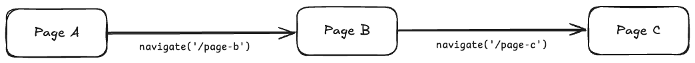
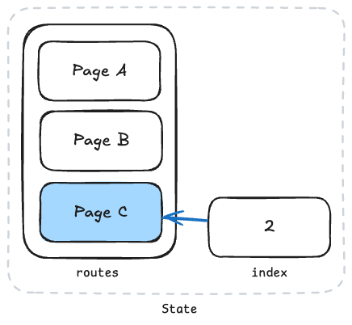
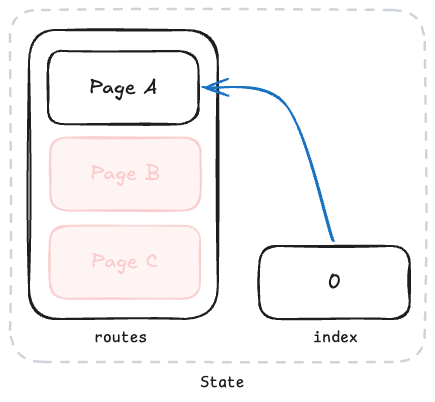

<script setup>
  import UsageSection from '../../components/UsageSection.vue'
</script>

# Navigating Screens

Granite Router makes it easy to handle routing tasks such as navigating to new screens in your application or controlling screen history.

We'll explain various routing features using the example code below.

::: info
Granite Router operates based on [React Navigation](https://reactnavigation.org/).
:::

## Example Code

The example code consists of a total of 3 pages, and the structure is as follows:

```
root
├─── pages
│    ├─── page-a.tsx
│    ├─── page-b.tsx
│    └─── page-c.tsx
└─── src
     └─── ...
```

::: details `page-a.tsx` Source Code

```tsx
// page-a.tsx
import { StyleSheet, View, Text, Pressable } from 'react-native';
import { createRoute, useNavigation } from '@granite-js/react-native';

export const Route = createRoute('/page-a', {
  validateParams: (params) => params,
  component: PageA,
});

function PageA() {
  const navigation = useNavigation();

  const handlePress = () => {
    navigation.navigate('/page-b');
  };

  return (
    <View style={[styles.container, { backgroundColor: '#3182f6' }]}>
      <Text style={styles.text}>Page A</Text>
      <Pressable onPress={handlePress}>
        <Text style={styles.buttonLabel}>Go to Page B</Text>
      </Pressable>
    </View>
  );
}

const styles = StyleSheet.create({
  container: {
    flex: 1,
    justifyContent: 'center',
    alignItems: 'center',
    gap: 16,
    padding: 16,
  },
  text: {
    color: 'white',
    fontSize: 24,
  },
  buttonLabel: {
    color: 'white',
  },
});
```

:::

::: details `page-b.tsx` Source Code

```tsx
// page-b.tsx
import { createRoute, useNavigation } from '@granite-js/react-native';
import { StyleSheet, View, Text, Pressable } from 'react-native';

export const Route = createRoute('/page-b', {
  validateParams: (params) => params,
  component: PageB,
});

function PageB() {
  const navigation = useNavigation();

  // Function to go back to the previous screen.
  const handlePressBackButton = () => {
    if (navigation.canGoBack()) {
      navigation.goBack();
    } else {
      console.warn('Cannot go back to the previous screen.');
    }
  };

  const handlePressNextButton = () => {
    navigation.navigate('/page-c', {
      message: 'Hello!',
      date: new Date().getTime(),
    });
  };

  return (
    <View style={[styles.container, { backgroundColor: '#fe9800' }]}>
      <Text style={styles.text}>Page B</Text>
      <Pressable onPress={handlePressBackButton}>
        <Text style={styles.buttonLabel}>Go Back</Text>
      </Pressable>
      <Pressable onPress={handlePressNextButton}>
        <Text style={styles.buttonLabel}>Go to Page C</Text>
      </Pressable>
    </View>
  );
}

const styles = StyleSheet.create({
  container: {
    flex: 1,
    justifyContent: 'center',
    alignItems: 'center',
    gap: 16,
    padding: 16,
  },
  text: {
    color: 'white',
    fontSize: 24,
  },
  buttonLabel: {
    color: 'white',
  },
});
```

:::

::: details `page-c.tsx` Source Code

```tsx
// page-c.tsx
import { createRoute, useNavigation } from '@granite-js/react-native';
import { CommonActions } from '@granite-js/react-native/native/@react-navigation/native';
import { StyleSheet, View, Text, Pressable } from 'react-native';

export const Route = createRoute('/page-c', {
  validateParams: (params) => params as { message: string; date: number },
  component: PageC,
});

function PageC() {
  const navigation = useNavigation();
  const params = Route.useParams();

  const handlePressHomeButton = () => {
    navigation.dispatch((state) => {
      return CommonActions.reset({
        ...state,
        index: 0,
        routes: state.routes.filter((route) => route.name === '/page-a'),
      });
    });
  };

  return (
    <View style={[styles.container, { backgroundColor: '#f04452' }]}>
      <Text style={styles.text}>{params.message}</Text>
      <Text style={styles.text}>{params.date}</Text>
      <View style={styles.line} />
      <Text style={styles.text}>Page C</Text>
      <Pressable onPress={handlePressHomeButton}>
        <Text style={styles.buttonLabel}>Go to Home</Text>
      </Pressable>
    </View>
  );
}

const styles = StyleSheet.create({
  container: {
    flex: 1,
    justifyContent: 'center',
    alignItems: 'center',
    gap: 16,
    padding: 16,
  },
  text: {
    color: 'white',
    fontSize: 24,
  },
  buttonLabel: {
    color: 'white',
  },
});
```

:::

## Page A: Navigating Screens

<UsageSection assetType="image" assetPath="/usage/navigation/navigate-1.gif">

[`useNavigation`](https://reactnavigation.org/docs/use-navigation) is used to handle navigation between screens. With the [`navigate`](https://reactnavigation.org/docs/navigation-actions/#navigate) method, you can pass the path of the screen to navigate to and any necessary data.

```tsx
// page-a.tsx
import { createRoute, useNavigation } from '@granite-js/react-native';
import { StyleSheet, View, Text, Pressable } from 'react-native';

export const Route = createRoute('/page-a', {
  validateParams: (params) => params,
  component: PageA,
});

function PageA() {
  const navigation = useNavigation();

  const handlePress = () => {
    navigation.navigate('/page-b');
  };

  return (
    <View style={[styles.container, { backgroundColor: '#3182f6' }]}>
      <Text style={styles.text}>Page A</Text>
      <Pressable onPress={handlePress}>
        <Text style={styles.buttonLabel}>Go to Page B</Text>
      </Pressable>
    </View>
  );
}

const styles = StyleSheet.create({
  container: {
    flex: 1,
    justifyContent: 'center',
    alignItems: 'center',
    gap: 16,
    padding: 16,
  },
  text: {
    color: 'white',
    fontSize: 24,
  },
  buttonLabel: {
    color: 'white',
  },
});
```

### Key Points

- Get the `navigation` object using the `useNavigation` hook.
- Calling `navigation.navigate('/page-b')` navigates to 'Page B'.

</UsageSection>

## Page B: Going Back to the Previous Screen

<UsageSection assetType="image" assetPath="/usage/navigation/navigate-2.gif">

You can use the [`goBack`](https://reactnavigation.org/docs/navigation-actions/#goback) method to return to the previous screen. However, an error may occur if there is no previous screen history, so you should first check with [`canGoBack`](https://reactnavigation.org/docs/navigation-object/#cangoback).

```tsx
// page-b.tsx
import { createRoute, useNavigation } from '@granite-js/react-native';
import { StyleSheet, View, Text, Pressable } from 'react-native';

export const Route = createRoute('/page-b', {
  validateParams: (params) => params,
  component: PageB,
});

function PageB() {
  const navigation = useNavigation();

  // Function to go back to the previous screen.
  const handlePressBackButton = () => {
    if (navigation.canGoBack()) {
      navigation.goBack();
    } else {
      console.warn('Cannot go back to the previous screen.');
    }
  };

  const handlePressNextButton = () => {
    navigation.navigate('/page-c', {
      message: 'Hello!',
      date: new Date().getTime(),
    });
  };

  return (
    <View style={[styles.container, { backgroundColor: '#fe9800' }]}>
      <Text style={styles.text}>Page B</Text>
      <Pressable onPress={handlePressBackButton}>
        <Text style={styles.buttonLabel}>Go Back</Text>
      </Pressable>
      <Pressable onPress={handlePressNextButton}>
        <Text style={styles.buttonLabel}>Go to Page C</Text>
      </Pressable>
    </View>
  );
}

const styles = StyleSheet.create({
  container: {
    flex: 1,
    justifyContent: 'center',
    alignItems: 'center',
    gap: 16,
    padding: 16,
  },
  text: {
    color: 'white',
    fontSize: 24,
  },
  buttonLabel: {
    color: 'white',
  },
});
```

### Key Points

- Check if there is a previous screen with `canGoBack()`, and if so, call `goBack()`.
- Navigate to 'Page C' while passing data with `navigate('/page-c', { message: 'Hello!', date: new Date().getTime() })`.

</UsageSection>

## Page C: Using Received Data

<UsageSection assetType="image" assetPath="/usage/navigation/navigate-3.png">

The `Route.useParams` hook is used to get data passed from other screens.

At this time, if you set the `createRoute.validateParams` option, you can access the passed data while type-checking it (Type-Safe). This helps prevent errors due to incorrect data formats.

```tsx
// page-c.tsx
import { createRoute, useNavigation } from '@granite-js/react-native';
import { CommonActions } from '@granite-js/react-native';
import { StyleSheet, View, Text, Pressable } from 'react-native';

export const Route = createRoute('/page-c', {
  validateParams: (params) => params as { message: string; date: number },
  component: PageC,
});

function PageC() {
  const navigation = useNavigation();
  const params = Route.useParams();

  const handlePressHomeButton = () => {
    navigation.dispatch((state) => {
      return CommonActions.reset({
        ...state,
        index: 0,
        routes: state.routes.filter((route) => route.name === '/page-a'),
      });
    });
  };

  return (
    <View style={[styles.container, { backgroundColor: '#f04452' }]}>
      <Text style={styles.text}>{params.message}</Text>
      <Text style={styles.text}>{params.date}</Text>
      <View style={styles.line} />
      <Text style={styles.text}>Page C</Text>
      <Pressable onPress={handlePressHomeButton}>
        <Text style={styles.buttonLabel}>Go to Home</Text>
      </Pressable>
    </View>
  );
}

const styles = StyleSheet.create({
  container: {
    flex: 1,
    justifyContent: 'center',
    alignItems: 'center',
    gap: 16,
    padding: 16,
  },
  text: {
    color: 'white',
    fontSize: 24,
  },
  buttonLabel: {
    color: 'white',
  },
});
```

### Key Points

- Use the `Route.useParams` hook to access data (parameters) passed from the URL.
- Set the `createRoute.validateParams` option to safely use data by type-checking it (Type-Safe).

</UsageSection>

## Defining Screen Parameter Types

Define a Route component like the one below for each page.
Here, the `validateParams` option defines the type of parameters that the screen will receive.

```tsx
export const Route = createRoute('/page-c', {
  validateParams: (params) => params as { message: string; date: number },
  component: PageC,
});
```

In the code above, `validateParams` defines the type of parameters to include two fields: `message` and `date`.

This allows other code using `useNavigate` or `useParams` to clearly know the required path and the data to be passed through type checking. This improves code safety and readability.

## Resetting Routing State



The state immediately after navigating in the order of Page A → Page B → Page C can be represented as shown in the figure below.

<div align="center">



</div>

Page A, Page B, and Page C remain in the `routes` history in order, and the `index` value points to 2, which is the position of the last navigated page, Page C.

You can use `reset` to initialize the screen navigation history. For example, if you want to go back to 'Page A' after navigating 'Page A → B → C' and delete the B and C history, use [`CommonActions.reset`](https://reactnavigation.org/docs/navigation-actions/#reset).

```tsx
navigation.dispatch(
  CommonActions.reset({
    index: 0,
    routes: [{ name: '/page-a' }],
  })
);
```

<div align="center">



</div>

### Key Points

- Use `CommonActions.reset` to keep only a specific screen in the history and delete the rest of the screen history.

## Render Router inside your app

`Granite.registerApp` registers your component and supplies native initial props and visibility lifecycle. It does not create a router. Import the standalone `Router` from `@granite-js/react-native/router` and render it where navigation is needed. A routerless app can import registration APIs from `@granite-js/react-native/core` without loading React Navigation.

Router owns its NavigationContainer, native stack, safe-area provider, and back-handler scope. Each Router has independent navigation and back-handler state. You do not need to wrap it in a NavigationContainer or register it with Granite.

```tsx
import { useColorScheme } from 'react-native';
import { Granite, type InitialProps } from '@granite-js/react-native/core';
import { Router, BackButton } from '@granite-js/react-native/router';
import { closeView, getSchemeUri } from '@granite-js/react-native';
import { context } from '../require.context';

function App({ scheme }: InitialProps) {
  const dark = useColorScheme() === 'dark';

  return (
    <Router
      context={context}
      prefix="example://app"
      initialUrl={scheme}
      getInitialUrl={(url) => url ?? getSchemeUri()}
      onRootBack={closeView}
      defaultScreenOptions={({ routeIndex, onBack }) => ({
        headerTintColor: dark ? 'white' : 'black',
        title: routeIndex === 0 ? 'Welcome' : 'Details',
        ...(routeIndex === 0 && {
          headerLeft: (props) => <BackButton {...props} onPress={onBack} />,
        }),
      })}
    />
  );
}

export default Granite.registerApp(App, { appName: 'example' });
```

For a custom theme, place a component that calls `useTheme()` below your ThemeProvider and render Router from that component. Call hooks in the parent component, never inside `defaultScreenOptions`. Changing the resulting options updates mounted screens without resetting the stack. Keep Router's React key and route component identities stable.

`defaultScreenOptions` accepts an object or a function receiving the native-stack `route`, `navigation`, and `theme`, plus:

- `routeIndex`: this route's zero-based position, not the currently focused index. Duplicate pushes have distinct positions. A preloaded route not yet in the stack has index `-1`.
- `onBack`: runs registered back handlers, then goes back in the current navigation state or invokes `onRootBack` when no history remains. It does not directly remove the route that supplied the callback.

Router never calls a host close bridge itself. Supply `onRootBack` to connect one. Without it, root back has no host action and no default root back button is shown. Android hardware back at the root uses the supplied action; host-specific iOS gesture controls can be supplied through `setIosSwipeGestureEnabled` and `setiOSBackPressHandler`.

`initialUrl` and optional `getInitialUrl` resolve the entry URL on mount. Router does not infer them from a global app name or native bridge. Changing initial URL props does not navigate or reset an existing stack. Use navigation actions for subsequent navigation. `prefix` must match the URL scheme/host/path used by the app.

The legacy `defaultScreenOption` spelling is a deprecated Router prop retaining its original callback arguments. TypeScript rejects specifying both names; untyped callers use the plural option without merging. Page `screenOptions` and existing `navigation.setOptions` retain precedence. Existing non-root back-button behavior is retained.

### Migrating from automatic registration

This is a breaking registration API change:

- Move `context` and routing options from `Granite.registerApp` to `<Router>`.
- Render Router instead of returning the injected `children`; registration no longer inserts a Navigator.
- Replace registration's `initialScheme` with Router's `initialUrl`. Resolve function-based URLs in your app or `getInitialUrl`.
- Supply an explicit `prefix`, and `onRootBack` when the host view should close.
- Move gesture callbacks and `screenContainer` / `defaultErrorComponent` to Router.
- Move wrappers that use navigation/back hooks into `screenContainer` or page/layout components below Router. Providers used to compute options belong above Router.
- Replace wrappers that clone the injected Navigator with `defaultScreenOptions` on Router.

React Navigation remains the internal navigation engine. This change separates registration and Router composition; it does not replace the engine or the existing typed-route definition API.

## References

- [React Navigation Official Documentation](https://reactnavigation.org/)

Using React Navigation in this way makes it easy to handle navigation between screens, and you can implement various UX features through functions for passing data or manipulating history. Also, using it with TypeScript allows you to write safe and robust code.
