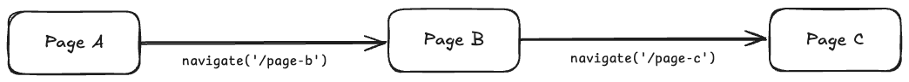
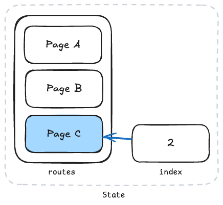
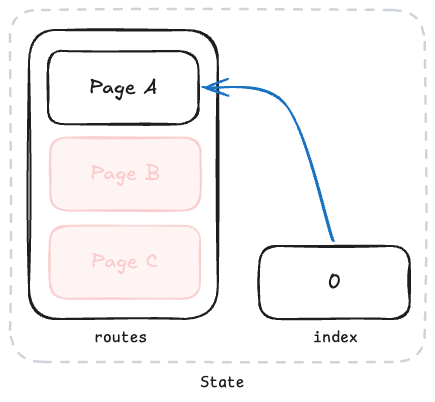

<script setup>
  import UsageSection from '../../../components/UsageSection.vue'
</script>

# 화면 이동하기

Granite Router는 애플리케이션에서 새로운 화면으로 이동하거나, 화면 히스토리를 제어하는 등의 라우팅 작업을 쉽게 처리할 수 있어요.

아래 예제 코드를 통해 다양한 라우팅 기능을 설명할게요.

::: info
Granite Route는 [React Navigation](https://reactnavigation.org/)을 기반으로 동작해요
:::

## 예제 코드

예제 코드는 총 3개의 페이지로 구성되어 있고, 구조는 아래와 같아요.

```
root
├─── pages
│    ├─── page-a.tsx
│    ├─── page-b.tsx
│    └─── page-c.tsx
└─── src
     └─── ...
```

::: details `page-a.tsx` 소스코드

```tsx
// page-a.tsx
import { StyleSheet, View, Text, Pressable } from 'react-native';
import { createRoute, useNavigation } from '@granite-js/react-native';

export const Route = createRoute('/page-a', {
  validateParams: (params) => params,
  component: PageA,
});

function PageA() {
  const navigation = useNavigation();

  const handlePress = () => {
    navigation.navigate('/page-b');
  };

  return (
    <View style={[styles.container, { backgroundColor: '#3182f6' }]}>
      <Text style={styles.text}>Page A</Text>
      <Pressable onPress={handlePress}>
        <Text style={styles.buttonLabel}>B 페이지로 이동하기</Text>
      </Pressable>
    </View>
  );
}

const styles = StyleSheet.create({
  container: {
    flex: 1,
    justifyContent: 'center',
    alignItems: 'center',
    gap: 16,
    padding: 16,
  },
  text: {
    color: 'white',
    fontSize: 24,
  },
  buttonLabel: {
    color: 'white',
  },
});
```

:::

::: details `page-b.tsx` 소스코드

```tsx
// page-b.tsx
import { createRoute, useNavigation } from '@granite-js/react-native';
import { StyleSheet, View, Text, Pressable } from 'react-native';

export const Route = createRoute('/page-b', {
  validateParams: (params) => params,
  component: PageB,
});

function PageB() {
  const navigation = useNavigation();

  // 이전 화면으로 돌아가는 함수예요.
  const handlePressBackButton = () => {
    if (navigation.canGoBack()) {
      navigation.goBack();
    } else {
      console.warn('이전 화면으로 이동할 수 없습니다.');
    }
  };

  const handlePressNextButton = () => {
    navigation.navigate('/page-c', {
      message: '안녕!',
      date: new Date().getTime(),
    });
  };

  return (
    <View style={[styles.container, { backgroundColor: '#fe9800' }]}>
      <Text style={styles.text}>Page B</Text>
      <Pressable onPress={handlePressBackButton}>
        <Text style={styles.buttonLabel}>이전으로 이동하기</Text>
      </Pressable>
      <Pressable onPress={handlePressNextButton}>
        <Text style={styles.buttonLabel}>C 페이지로 이동하기</Text>
      </Pressable>
    </View>
  );
}

const styles = StyleSheet.create({
  container: {
    flex: 1,
    justifyContent: 'center',
    alignItems: 'center',
    gap: 16,
    padding: 16,
  },
  text: {
    color: 'white',
    fontSize: 24,
  },
  buttonLabel: {
    color: 'white',
  },
});
```

:::

::: details `page-c.tsx` 소스코드

```tsx
// page-c.tsx
import { createRoute, useNavigation } from '@granite-js/react-native';
import { CommonActions } from '@granite-js/react-native/native/@react-navigation/native';
import { StyleSheet, View, Text, Pressable } from 'react-native';

export const Route = createRoute('/page-c', {
  validateParams: (params) => params as { message: string; date: number },
  component: PageC,
});

function PageC() {
  const navigation = useNavigation();
  const params = Route.useParams();

  const handlePressHomeButton = () => {
    navigation.dispatch((state) => {
      return CommonActions.reset({
        ...state,
        index: 0,
        routes: state.routes.filter((route) => route.name === '/page-a'),
      });
    });
  };

  return (
    <View style={[styles.container, { backgroundColor: '#f04452' }]}>
      <Text style={styles.text}>{params.message}</Text>
      <Text style={styles.text}>{params.date}</Text>
      <View style={styles.line} />
      <Text style={styles.text}>Page C</Text>
      <Pressable onPress={handlePressHomeButton}>
        <Text style={styles.buttonLabel}>처음으로 이동하기</Text>
      </Pressable>
    </View>
  );
}

const styles = StyleSheet.create({
  container: {
    flex: 1,
    justifyContent: 'center',
    alignItems: 'center',
    gap: 16,
    padding: 16,
  },
  text: {
    color: 'white',
    fontSize: 24,
  },
  buttonLabel: {
    color: 'white',
  },
});
```

:::

## 페이지 A: 화면 이동하기

<UsageSection assetType="image" assetPath="/usage/navigation/navigate-1.gif">

[`useNavigation`](https://reactnavigation.org/docs/use-navigation)은 화면 간 이동을 처리할 때 사용해요. [`navigate`](https://reactnavigation.org/docs/navigation-actions/#navigate) 메서드로 이동할 화면의 경로와 필요한 데이터를 함께 전달할 수 있어요.

```tsx
// page-a.tsx
import { createRoute, useNavigation } from '@granite-js/react-native';
import { StyleSheet, View, Text, Pressable } from 'react-native';

export const Route = createRoute('/page-a', {
  validateParams: (params) => params,
  component: PageA,
});

function PageA() {
  const navigation = useNavigation();

  const handlePress = () => {
    navigation.navigate('/page-b');
  };

  return (
    <View style={[styles.container, { backgroundColor: '#3182f6' }]}>
      <Text style={styles.text}>Page A</Text>
      <Pressable onPress={handlePress}>
        <Text style={styles.buttonLabel}>B 페이지로 이동하기</Text>
      </Pressable>
    </View>
  );
}

const styles = StyleSheet.create({
  container: {
    flex: 1,
    justifyContent: 'center',
    alignItems: 'center',
    gap: 16,
    padding: 16,
  },
  text: {
    color: 'white',
    fontSize: 24,
  },
  buttonLabel: {
    color: 'white',
  },
});
```

### 주요 포인트

- `useNavigation` 훅을 사용해 `navigation` 객체를 가져와요.
- `navigation.navigate('/page-b')`를 호출하면 'B' 페이지로 이동해요.

</UsageSection>

## 페이지 B: 이전 화면으로 돌아가기

<UsageSection assetType="image" assetPath="/usage/navigation/navigate-2.gif">

[`goBack`](https://reactnavigation.org/docs/navigation-actions/#goback) 메서드를 사용하면 이전 화면으로 돌아갈 수 있어요. 하지만 이전 화면 기록이 없는 경우에는 에러가 발생할 수 있으니, [`canGoBack`](https://reactnavigation.org/docs/navigation-object/#cangoback)으로 먼저 확인해야 해요.

```tsx
// page-b.tsx
import { createRoute, useNavigation } from '@granite-js/react-native';
import { StyleSheet, View, Text, Pressable } from 'react-native';

export const Route = createRoute('/page-b', {
  validateParams: (params) => params,
  component: PageB,
});

function PageB() {
  const navigation = useNavigation();

  // 이전 화면으로 돌아가는 함수예요.
  const handlePressBackButton = () => {
    if (navigation.canGoBack()) {
      navigation.goBack();
    } else {
      console.warn('이전 화면으로 이동할 수 없습니다.');
    }
  };

  const handlePressNextButton = () => {
    navigation.navigate('/page-c', {
      message: '안녕!',
      date: new Date().getTime(),
    });
  };

  return (
    <View style={[styles.container, { backgroundColor: '#fe9800' }]}>
      <Text style={styles.text}>Page B</Text>
      <Pressable onPress={handlePressBackButton}>
        <Text style={styles.buttonLabel}>이전으로 이동하기</Text>
      </Pressable>
      <Pressable onPress={handlePressNextButton}>
        <Text style={styles.buttonLabel}>C 페이지로 이동하기</Text>
      </Pressable>
    </View>
  );
}

const styles = StyleSheet.create({
  container: {
    flex: 1,
    justifyContent: 'center',
    alignItems: 'center',
    gap: 16,
    padding: 16,
  },
  text: {
    color: 'white',
    fontSize: 24,
  },
  buttonLabel: {
    color: 'white',
  },
});
```

### 주요 포인트

- `canGoBack()`으로 이전 화면이 있는지 확인하고, 있으면 `goBack()`을 호출해요.
- `navigate('/page-c', { message: '안녕!', date: new Date().getTime() })`로 데이터를 전달하면서 'C' 페이지로 이동해요.

</UsageSection>

## 페이지 C: 전달받은 데이터 사용하기

<UsageSection assetType="image" assetPath="/usage/navigation/navigate-3.png">

`Route.useParams` 훅은 다른 화면에서 전달된 데이터를 가져올 때 사용해요.

이때, `createRoute.validateParams` 옵션을 설정하면 전달된 데이터를 타입 검증(Type-Safe)하면서 접근할 수 있어요. 이를 통해 잘못된 데이터 형식으로 인한 에러를 방지할 수 있어요.

```tsx
// page-c.tsx
import { createRoute, useNavigation } from '@granite-js/react-native';
import { CommonActions } from '@granite-js/react-native';
import { StyleSheet, View, Text, Pressable } from 'react-native';

export const Route = createRoute('/page-c', {
  validateParams: (params) => params as { message: string; date: number },
  component: PageC,
});

function PageC() {
  const navigation = useNavigation();
  const params = Route.useParams();

  const handlePressHomeButton = () => {
    navigation.dispatch((state) => {
      return CommonActions.reset({
        ...state,
        index: 0,
        routes: state.routes.filter((route) => route.name === '/page-a'),
      });
    });
  };

  return (
    <View style={[styles.container, { backgroundColor: '#f04452' }]}>
      <Text style={styles.text}>{params.message}</Text>
      <Text style={styles.text}>{params.date}</Text>
      <View style={styles.line} />
      <Text style={styles.text}>Page C</Text>
      <Pressable onPress={handlePressHomeButton}>
        <Text style={styles.buttonLabel}>처음으로 이동하기</Text>
      </Pressable>
    </View>
  );
}

const styles = StyleSheet.create({
  container: {
    flex: 1,
    justifyContent: 'center',
    alignItems: 'center',
    gap: 16,
    padding: 16,
  },
  text: {
    color: 'white',
    fontSize: 24,
  },
  buttonLabel: {
    color: 'white',
  },
});
```

### 주요 포인트

- `Route.useParams` 훅을 사용하면 URL에서 전달된 데이터(매개변수)에 접근할 수 있어요.
- `createRoute.validateParams` 옵션을 설정하면 데이터 타입을 검증하면서(Type-Safe) 안전하게 사용할 수 있어요.

</UsageSection>

## 화면 파라미터 타입 정의하기

페이지마다 아래와 같은 Route 컴포넌트를 정의해요.
여기서 `validateParams` 옵션은 해당 화면에서 받을 파라미터의 타입을 정의해요.

```tsx
export const Route = createRoute('/page-c', {
  validateParams: (params) => params as { message: string; date: number },
  component: PageC,
});
```

위 코드에서 `validateParams`는 `message`와 `date`라는 두 필드를 포함한 매개변수를 타입으로 정의해요.

이를 통해 다른 코드에서 `useNavigate`나 `useParams`를 사용할 때, 타입 검사를 통해 필요한 경로와 전달해야 할 데이터를 명확히 알 수 있어요. 이렇게 하면 코드의 안전성과 가독성이 높아져요.

## 라우팅 상태 초기화하기



페이지 A → 페이지 B → 페이지 C 순서로 이동한 직후의 상태는 아래와 그림과 같이 같이 나타낼 수 있어요.

<div align="center">



</div>

페이지 A, 페이지 B, 페이지 C가 순서대로 `routes` 기록에 남아 있고, `index` 값은 마지막으로 이동한 페이지 C의 위치인 2를 가리켜요.

`reset`을 사용하면 화면 이동 기록을 초기화할 수 있어요. 예를 들어, '페이지 A → B → C'로 이동한 후에 '페이지 A'로 돌아가면서 B와 C 기록을 삭제하고 싶다면, [`CommonActions.reset`](https://reactnavigation.org/docs/navigation-actions/#reset)을 사용해요.

```tsx
navigation.dispatch(
  CommonActions.reset({
    index: 0,
    routes: [{ name: '/page-a' }],
  })
);
```

<div align="center">



</div>

### 주요 포인트

- `CommonActions.reset`으로 특정 화면만 기록에 남기고 나머지 화면 기록을 삭제할 수 있어요.

## 앱 안에서 Router 렌더링하기

`Granite.registerApp`은 앱 컴포넌트를 등록하고 네이티브 초기 props와 visibility 생명주기를 제공해요. Router는 자동으로 만들지 않아요. 구현은 별도 `@granite-js/router` 패키지가 소유하고 `@granite-js/react-native`가 dependency로 가져요. 호스트와 연결된 `Router` adapter를 `@granite-js/react-native/router`에서 가져와 필요한 위치에서 렌더링하세요. 라우팅이 없는 앱은 `@granite-js/react-native/core`에서 등록 API를 가져와 React Navigation을 로드하지 않고 사용할 수 있어요.

Router는 NavigationContainer, native stack, safe-area provider와 뒤로가기 핸들러 범위를 자체적으로 관리해요. 각 Router의 navigation 상태와 뒤로가기 핸들러는 독립적이에요. adapter가 호스트 activity를 전달하며 Router 패키지는 등록 런타임이나 호스트 bridge를 import하지 않아요. NavigationContainer로 감싸거나 Granite에 Router를 등록할 필요가 없어요.

```tsx
import { useColorScheme } from 'react-native';
import { Granite, type InitialProps } from '@granite-js/react-native/core';
import { Router, BackButton } from '@granite-js/react-native/router';
import { closeView, getSchemeUri } from '@granite-js/react-native';
import { context } from '../require.context';

function App({ scheme }: InitialProps) {
  const dark = useColorScheme() === 'dark';

  return (
    <Router
      context={context}
      prefix="example://app"
      initialUrl={scheme}
      getInitialUrl={(url) => url ?? getSchemeUri()}
      onRootBack={closeView}
      defaultScreenOptions={({ routeIndex, onBack }) => ({
        headerTintColor: dark ? 'white' : 'black',
        title: routeIndex === 0 ? 'Welcome' : 'Details',
        ...(routeIndex === 0 && {
          headerLeft: (props) => <BackButton {...props} onPress={onBack} />,
        }),
      })}
    />
  );
}

export default Granite.registerApp(App, { appName: 'example' });
```

커스텀 테마를 사용한다면 ThemeProvider 아래의 컴포넌트에서 `useTheme()`을 호출하고, 해당 컴포넌트가 Router를 렌더링하도록 구성하세요. 훅은 부모 컴포넌트에서 호출하고 `defaultScreenOptions` 안에서는 호출하지 않아요. 계산된 옵션이 바뀌면 기존 스택과 화면 상태를 유지하면서 반영해요. Router의 React key와 route 컴포넌트 identity를 유지해야 해요.

`defaultScreenOptions`는 객체 또는 함수를 받아요. 함수에는 native-stack의 `route`, `navigation`, `theme`와 다음 값이 전달돼요.

- `routeIndex`: 현재 활성 index가 아닌 해당 route의 0부터 시작하는 스택 위치예요. 같은 페이지를 push해도 서로 다른 위치를 가지며, 아직 스택에 없는 preload route는 `-1`이에요.
- `onBack`: 등록된 핸들러를 거친 뒤 현재 navigation 상태에서 뒤로 이동하거나, 돌아갈 화면이 없으면 `onRootBack`을 호출해요. callback을 받은 route를 직접 제거하지는 않아요.

Router는 호스트 닫기 bridge를 직접 호출하지 않아요. 필요한 앱에서 `onRootBack`으로 연결하세요. 생략하면 루트에서 호스트 동작을 실행하지 않고 기본 루트 뒤로가기 버튼도 표시하지 않아요. Android hardware back도 루트에서 지정한 동작을 사용해요. 호스트의 iOS 제스처 제어는 `setIosSwipeGestureEnabled`, `setiOSBackPressHandler`로 주입할 수 있어요.

`initialUrl`과 선택적인 `getInitialUrl`은 마운트 시 진입 URL을 결정해요. Router는 전역 앱 이름이나 네이티브 bridge에서 자동으로 읽지 않아요. 초기 URL props가 바뀌어도 기존 스택을 초기화하거나 이동하지 않으며, 이후 이동에는 navigation action을 사용해요. `prefix`는 앱에서 사용하는 URL의 scheme/host/path와 일치해야 해요.

기존 단수형 `defaultScreenOption`은 원래 callback 인자를 유지하는 deprecated Router prop이에요. 두 이름을 함께 지정하면 타입 오류가 나고, 타입 검사 없는 호출에서는 복수형만 사용해요. 페이지 `screenOptions`와 기존 `navigation.setOptions`가 우선하며, 후속 화면의 기본 뒤로가기 버튼 동작은 유지해요.

### 자동 등록 방식에서 마이그레이션하기

앱 등록 API의 호환성이 깨지는 변경이에요.

- `context`와 라우팅 설정을 `Granite.registerApp`에서 `<Router>`로 옮기세요.
- 주입되던 `children`을 반환하는 대신 Router를 직접 렌더링하세요. 등록 함수가 Navigator를 넣어주지 않아요.
- 등록 옵션의 `initialScheme`은 Router의 `initialUrl`로 옮기세요. 함수형 URL은 앱이나 `getInitialUrl`에서 계산하세요.
- `prefix`를 명시하고, 호스트 화면을 닫아야 하면 `onRootBack`을 연결하세요.
- 제스처 callback, `screenContainer`, `defaultErrorComponent`는 Router에 전달하세요.
- navigation/back 훅을 쓰는 래퍼는 Router 아래의 `screenContainer` 또는 페이지/레이아웃으로 옮기세요. 옵션 계산에 사용하는 Provider는 Router 위에 둬요.
- 주입된 Navigator를 clone하는 래퍼는 Router의 `defaultScreenOptions`로 대체하세요.

### Router 패키지만 사용하기

호환되는 `@granite-js/native`, `react`, `react-native` peer와 함께 `@granite-js/router`를 설치하세요. `Router`, `createRoute`, navigation/back 훅을 `@granite-js/router`에서 직접 가져오면 Granite 등록 없이 사용할 수 있어요. 독립 Router는 기본적으로 AppState를 사용하고, 호스트가 activity를 관리한다면 `isActive`를 전달해요.

기존 `@granite-js/react-native`의 루트와 `/router` 경로도 새 패키지와 같은 route 정의와 back-handler context를 공유해요. 새로 생성하는 route 타입은 `@granite-js/router`를 확장하고, 이전 `@granite-js/react-native` 타입 확장도 호환돼요. 새 생성 파일이나 직접 import를 사용한다면 앱 dependencies에 `@granite-js/router`를 추가하세요.

내부 navigation 엔진은 React Navigation을 유지해요. 이번 변경은 앱 등록과 Router 구성을 분리하며, 엔진이나 기존 typed-route 정의 API를 교체하지 않아요.

## 레퍼런스

- [React Navigation 공식 문서](https://reactnavigation.org/)

이렇게 React Navigation을 사용하면 화면 간 이동을 쉽게 처리할 수 있고, 데이터를 전달하거나 기록을 조작하는 기능을 통해 다양한 UX를 구현할 수 있어요. 또한 타입스크립트와 함께 사용하면 안전하고 견고한 코드를 작성할 수 있답니다.
